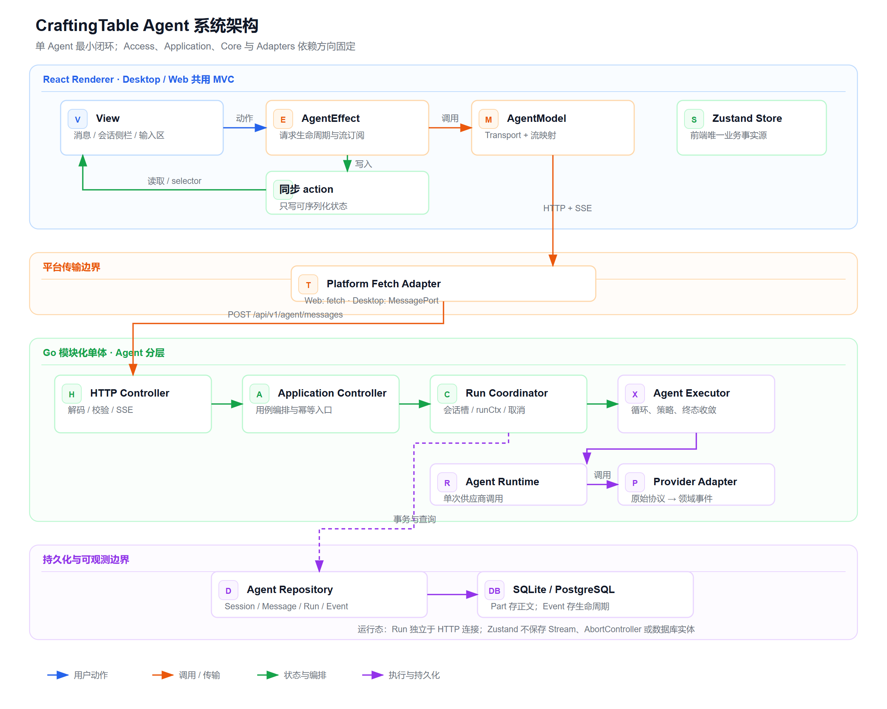
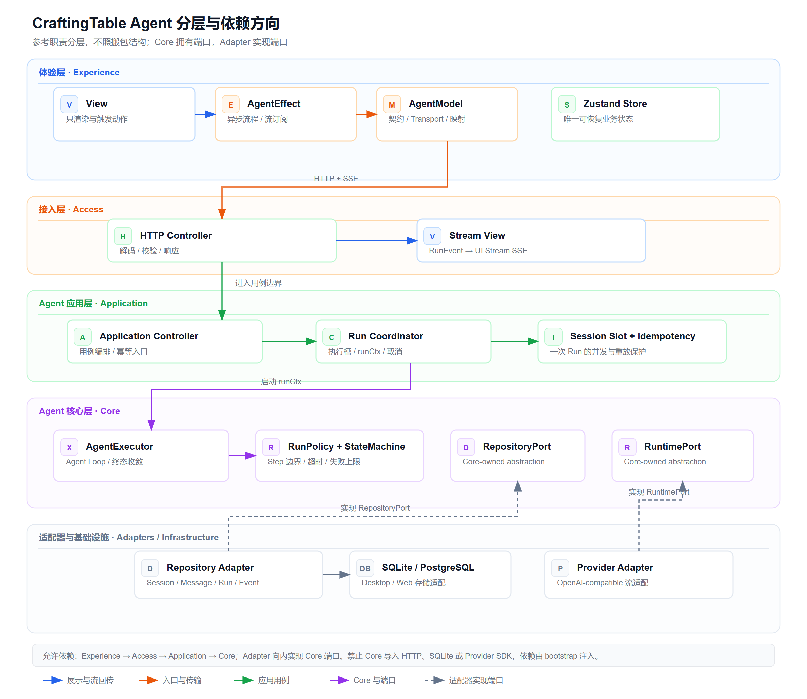
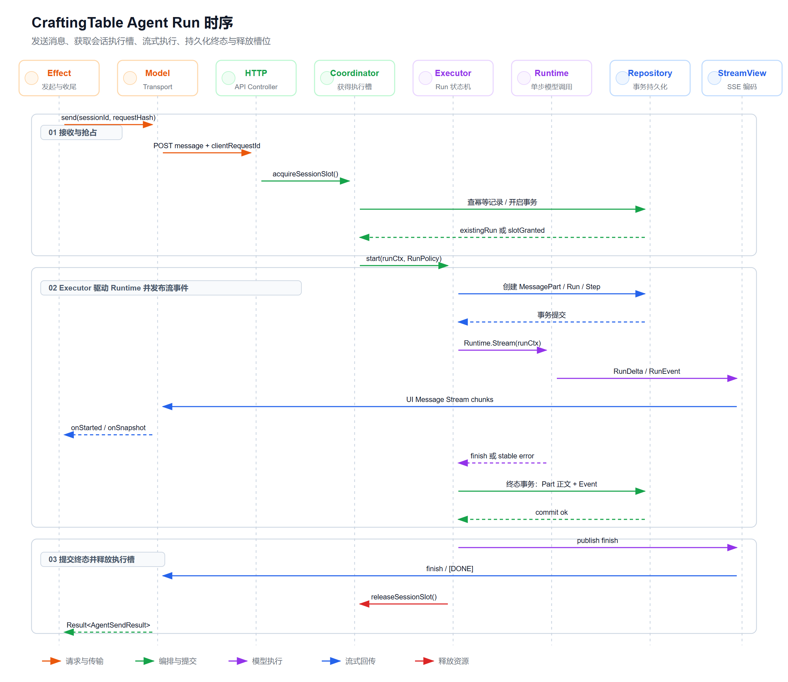
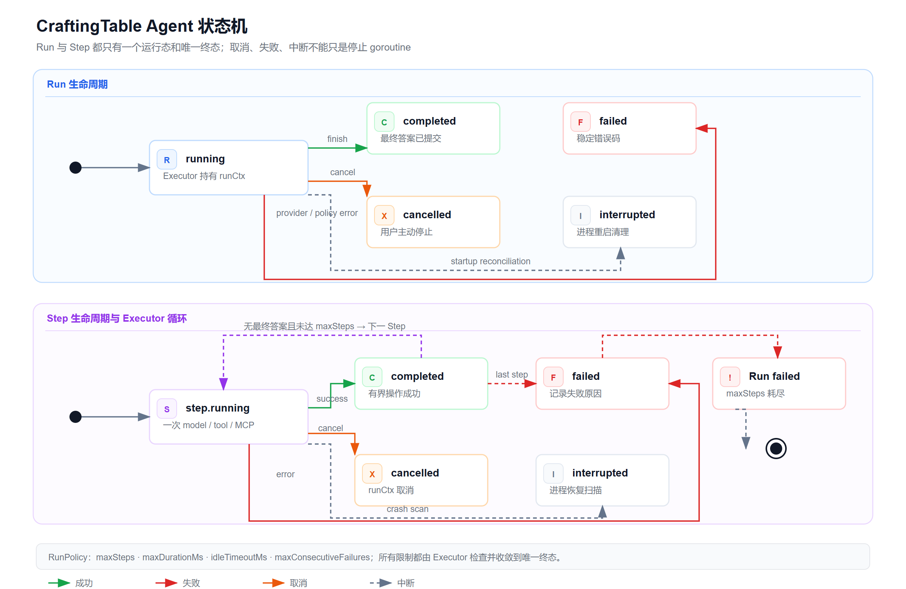
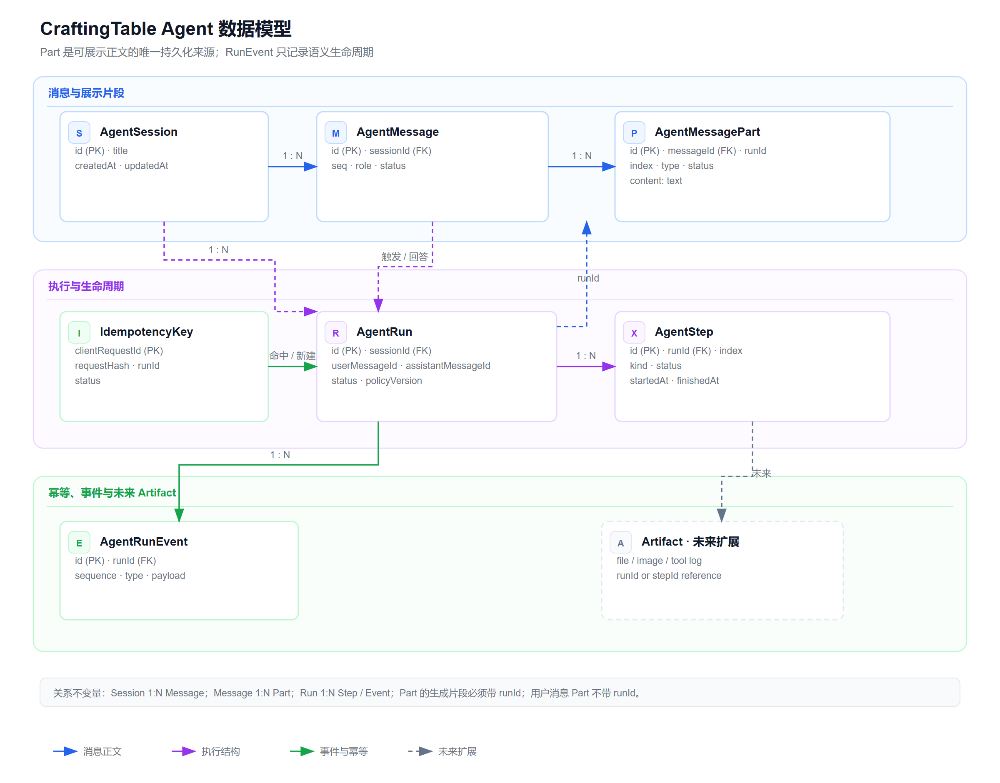

# CraftingTable Agent 架构图

日期：2026-11-05
状态：已确认
范围：单 Agent 会话、Run 执行、流式协议、状态与持久化边界
关联设计：[CraftingTable Agent 设计](../superpowers/specs/2026-11-05-craftingtable-agent-design.md)
工程规范：[CraftingTable 工程化设计规范](../superpowers/specs/2026-11-05-craftingtable-engineering-design.md)
术语基线：[CraftingTable 术语表](../glossary.md)

## 系统架构



这张图回答“系统由谁组成、依赖朝哪里走”：

- View 只读 Store、只调用 Effect。
- Effect 调用 Model，并把结果同步写入 Zustand Store。
- Zustand 是前端业务状态唯一事实源。
- Web 使用同源 fetch，Desktop 使用 Electron MessagePort bridge 代理到 Go sidecar。
- Go 侧按 Access → Agent Application → Agent Core → Adapters 分层。
- Runtime 不访问数据库，Repository 不依赖 HTTP。

源文件：[agent-system-architecture.svg](./agent-system-architecture.svg)

## 分层与依赖方向



这张图回答“哪些职责属于哪一层，依赖只能朝哪里走”：

| 层 | 主要组件 | 边界 |
| --- | --- | --- |
| Experience | View、Effect、Model、Zustand | 只通过 Transport 访问 Access，不导入 Go Domain 或具体 Provider |
| Access | HTTP Controller、SSE Stream View | 只做协议解码、校验和响应，不执行 Agent Loop 或事务 |
| Agent Application | Application Controller、Coordinator、Session Slot、Idempotency | 组织用例、执行槽、幂等和取消，不依赖具体数据库或 Provider |
| Agent Core | Executor、RunPolicy、状态机、上下文组装 | 只依赖 Domain 和 Port，不导入 HTTP、SQLite 或 Provider SDK |
| Adapters / Infrastructure | Provider Adapter、Repository Adapter、SQLite/PostgreSQL、Logger、Clock | 向内实现 Port，由 composition root 创建并注入 |

依赖规则：

```text
Experience -> Access -> Application -> Core
Adapters / Infrastructure -> implement Port
Bootstrap -> create Adapter -> inject Port
```

这里只参考外部 Agent 框架的职责分层，不复制其 npm 包结构。UI、外部机器人和平台集成不放在同一层；工具、Skills、MCP 和多 Agent 继续作为 Core 与 Application 的未来扩展能力。

源文件：[agent-layered-architecture.svg](./agent-layered-architecture.svg)

## Run 时序



这张图回答“一条消息怎样变成一次完整 Run”：

1. Effect 发起发送，Model 计算请求摘要并调用 HTTP API。
2. Coordinator 原子获取会话执行槽，并检查 `clientRequestId` 幂等记录。
3. Executor 在独立 `runCtx` 中创建 Run、Step、Part 和初始事件。
4. Runtime 流式输出领域事件，Stream View 将其编码为项目维护的 UI Message Stream 兼容 SSE 子集。
5. 终态事务先提交正文与生命周期事件，再发送 finish，最后释放会话执行槽。
6. 浏览器断开只结束当前订阅，不取消服务端 Run；用户停止才取消 `runCtx`。

源文件：[agent-run-sequence.svg](./agent-run-sequence.svg)

## Run 与 Step 状态机



这张图回答“什么时候算结束，以及失败路径怎样收敛”：

- Run 和 Step 都只有一个 `running` 状态。
- 终态固定为 `completed`、`failed`、`cancelled` 或 `interrupted`。
- 取消、超时、进程重启和策略超限都必须进入唯一终态，不能只停止 goroutine。
- `RunPolicy` 由 Executor 检查，Runtime 不能自行递归或扩展 Step 数量。

源文件：[agent-run-state-machine.svg](./agent-run-state-machine.svg)

## 数据模型



这张图回答“内容、执行和生命周期分别存在哪里”：

- Session 1:N Message，Message 1:N MessagePart。
- Run 1:N Step，Run 1:N RunEvent。
- `MessagePart` 是可展示正文的唯一持久化来源。
- `RunEvent` 只记录语义生命周期，不保存完整正文或 token delta。
- 用户消息 Part 没有 `runId`，助手消息的生成 Part 必须带 `runId`。
- Artifact 是未来的虚线扩展位，不属于当前单 Agent 最小闭环。

源文件：[agent-data-model.svg](./agent-data-model.svg)

## 当前边界

当前主线只实现单 Agent：

- 一次只维护一条 Live Run。
- 一次 Run 当前只有一个 model Step。
- 不接入工具、Skills、MCP、多 Agent 或评测平台。

以下能力只保留领域模型和协议扩展点，不进入当前执行链路：

- 工具调用与 Tool Registry。
- Skills 版本化和上下文注入。
- MCP Client。
- 父子 Run 和子 Agent。
- Evaluation Platform 与 SWE-bench。
- Redis 流缓存、租约和持久化执行引擎。

## 重新生成

```text
python .\scripts\generateAgentArchitectureDiagrams.py
node .\scripts\exportAgentArchitecturePng.mjs
```

五张 SVG 已通过 `fireworks-tech-graph` 的 XML、marker、碰撞、几何和组合质量检查；PNG 为 1200px 画布宽度、2x 导出并完成视觉回读。
